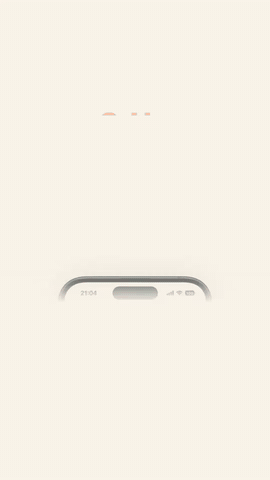
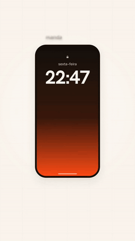
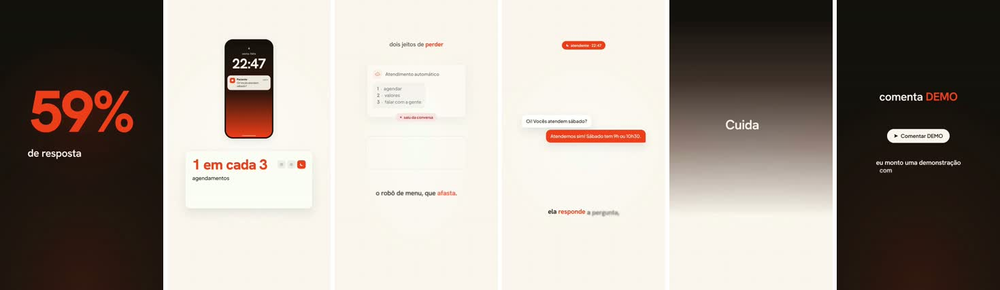

# anti-slop-motion

**An agent skill (Claude Code / Codex) that makes motion-design reels that don't look like AI slop.** It uses real UI inside a realistic phone, the camera follows the narration, and the agent critiques its own frames before you see them.

[Português](#português)

<table>
  <tr>
    <td align="center"><a href="https://www.instagram.com/p/Dd1QHlShibu/"></a></td>
    <td align="center"><a href="https://www.instagram.com/p/DdzNWVlhR_F/"></a></td>
    <td align="center"><a href="https://www.instagram.com/p/DdyxU39ht7u/"></a></td>
  </tr>
  <tr>
    <td align="center"><b>oi-sem-resposta</b><br>WhatsApp bot vs. AI receptionist<br><a href="docs/videos/oi-sem-resposta.mp4">mp4 with audio</a> · <a href="https://www.instagram.com/p/Dd1QHlShibu/">Instagram</a></td>
    <td align="center"><b>cadeira-vazia</b><br>No-shows, calendar + chat<br><a href="docs/videos/cadeira-vazia.mp4">mp4 with audio</a> · <a href="https://www.instagram.com/p/DdzNWVlhR_F/">Instagram</a></td>
    <td align="center"><b>cuida-da-noite</b><br>Kinetic type + UI cards<br><a href="docs/videos/cuida-da-noite.mp4">mp4 with audio</a> · <a href="https://www.instagram.com/p/DdyxU39ht7u/">Instagram</a></td>
  </tr>
</table>

All three were made with this skill: Fish Audio narration, real WhatsApp, Calendar and Instagram screens, and HyperFrames for the render. The GIFs are silent 9-second cuts. Open the mp4 to watch with sound.

## Why it's not "just a prompt"

AI video becomes slop when it **shows things that don't exist** (invented UI, generic icons, a gradient title fading in) and when **nobody looks at the frames** before delivering. This skill puts the agent through a designer's process:

1. **Script first, with word-level timing.** The narration sets every cut and caption.
2. **Reference → style guide.** It copies a reference video's grammar (rhythm, type, camera), never its content.
3. **Real screens only.** It uses client prints, logged-in browser captures, or a faithful app kit edited with real text. Nothing is drawn from imagination.
4. **Stills board before animating.** You approve one key frame per scene.
5. **Self-critique.** A contact sheet, a 12-frame strip and a phone-size test, scored 1–10. The agent fixes the 3 worst problems until every scene scores ≥ 8.
6. **Versioned deliveries.** A draft goes out, you give director's notes, then the final render at -14 LUFS with a poster and a caption.

Every reel goes through the critique strip before you see it. These are the real strips:




## Install

Requires Node 18+ and `ffmpeg`/`ffprobe` on PATH. [HyperFrames](https://github.com/heygen-com/hyperframes) runs through `npx` and downloads its own headless Chrome.

```bash
git clone --depth 1 https://github.com/pedromuniz-ia/anti-slop-motion-skill /tmp/asm
cp -r /tmp/asm/skills/anti-slop-motion ~/.claude/skills/anti-slop-motion
node ~/.claude/skills/anti-slop-motion/kit/motion.mjs help
```

For Codex or opencode, copy the same folder into that tool's skills directory (e.g. `~/.codex/skills/`). For a single project, use `<project>/.claude/skills/`. Copy only `skills/anti-slop-motion` (~170 KB): the repo root holds demo videos and is too big to load as a skill.

> [!TIP]
> For TTS narration, set `FISH_API_KEY` ([Fish Audio](https://fish.audio)). The word-alignment scripts in `kit/templates/projeto/` need Python 3 and `pip install faster-whisper`.

> [!IMPORTANT]
> No music is bundled. If you add background music, licensing it is your responsibility.

## Usage

Ask your agent for a video, for example:

> Make a 30-second vertical reel for a dental clinic showing how an AI assistant answers patients on WhatsApp and reschedules a missed appointment. Use real screenshots in a single iPhone mockup, show me the stills board before animating, and critique your own frames before sending the preview.

The skill triggers on "reel", "product video", "phone mockup video", "motion graphics", or "this looks like AI".

## Kit

| Path | What it does |
|---|---|
| `SKILL.md` | The workflow: hard rules, approval gates and gotchas |
| `references/` | Phase-by-phase method, how to get real screens, HyperFrames in practice |
| `kit/motion.mjs` | CLI with `ref`, `phone`, `alpha`, `critique`, `finish`, `sfx` and `receiver` (Node + ffmpeg only) |
| `kit/templates/cena-celular.html` | Phone scene: a real screen in an iPhone, with camera moves and springs |
| `kit/templates/prancha-stills.html` | Stills board |
| `kit/templates/chat-scene.mjs` | Animated WhatsApp conversation generated from JSON |
| `kit/templates/projeto/` | Fish Audio voice, word alignment, captions and assembly, with a full example |

Made by [Pedro Muniz](https://github.com/pedromuniz-ia) · [@pedromuniz.web](https://www.instagram.com/pedromuniz.web/) on Instagram. Built on HyperFrames.

---

## Português

**Skill para Claude Code e Codex que cria reels em motion design sem cara de IA.** O vídeo usa interface real dentro de um celular realista, a câmera acompanha a narração, e o agente critica os próprios quadros antes de te entregar.

Os 3 vídeos lá em cima foram feitos com ela: narração no Fish Audio, telas reais de WhatsApp, agenda e Instagram, e render no HyperFrames.

### Por que não é "só um prompt"

1. **Roteiro primeiro, com tempo palavra a palavra.** A narração comanda cada corte e cada legenda.
2. **Referência vira guia de estilo.** O agente copia a gramática da referência, nunca o conteúdo.
3. **Só tela real.** Print do cliente, navegador logado ou kit fiel do app com texto real. Nada desenhado de cabeça.
4. **Prancha de stills antes de animar.** Você aprova um quadro-chave por cena.
5. **Autocrítica com nota de 1 a 10.** O agente corrige os 3 piores problemas até tudo passar de 8.
6. **Entregas versionadas.** Prévia, notas de diretor e final com áudio normalizado, capa e legenda.

### Instalação

```bash
git clone --depth 1 https://github.com/pedromuniz-ia/anti-slop-motion-skill /tmp/asm
cp -r /tmp/asm/skills/anti-slop-motion ~/.claude/skills/anti-slop-motion
node ~/.claude/skills/anti-slop-motion/kit/motion.mjs help
```

Para narração, defina `FISH_API_KEY`. Nenhuma música vem no pacote; se usar uma, a licença é por sua conta.

Exemplo de pedido: *"Faz um reel vertical de 30s para uma clínica mostrando a atendente de IA respondendo no WhatsApp e remarcando uma consulta. Usa prints reais num iPhone, me mostra a prancha antes de animar e critica teus quadros antes da prévia."*
